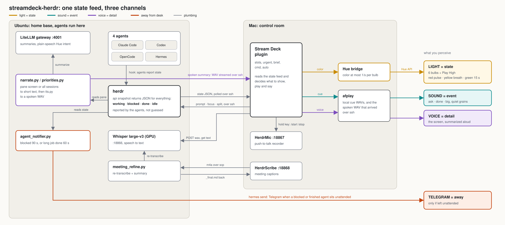

# streamdeck-herdr

**AI コーディングエージェントの管制室 — 光は状態、音は出来事、声は詳細。**

[English](README.md)

Linux 機の Herdr(エージェント向けのターミナル多重化)で、4種の CLI エージェント(Claude Code / Codex / OpenCode / Hermes)を並べて動かす。Mac の Stream Deck、Hue の電球、マイクを使い、その管制室にした。誰が何をしているかは部屋の色で**見え**、何か起きたら音で**分かり**、詳細は必要なときだけ声で**聞ける**。

> **これは作品の公開であり、そのまま動くプロダクトではない。** 1人分の環境(Ubuntu + Mac + Stream Deck + Hue)を前提にしている。パス・ホスト名・IP はダミー。設計を読むためのもので、そのままの実行は想定していない。

制作: 2026-10-01〜03。

## 考え方

「誰が自分を待っているか」を確かめるために4つの端末を見回すのは、管制室が取り除くべき注意の使い方だ。チャンネルごとに役目を1つだけ持たせた。

| チャンネル | 運ぶもの | 理由 |
|---|---|---|
| **光** | *状態* — 連続的・環境的 | 周辺視野で読める。手を止めずに済む |
| **音** | *出来事* — いま何か変わった | 短く静かに。リズムは刻まない(拍は「急かされる」) |
| **声** | *詳細* — 何が起きて、どうすべきか | 出来事のときだけ。画面の要約だけ |

| エージェントの状態 | 光(電球6) | 音 | 声 |
|---|---|---|---|
| 作業中 | 黄(ゆっくり呼吸) | 転がる粒(素材と間隔がランダム) | — |
| 確認待ち | 紫(速い点滅) | `ask`(疑問形の2音) | 画面を要約して読み上げ |
| 完了(30秒以上の作業) | 緑(15秒) | `done`(温かいパッド) | 同上 |
| 完了(20分以上の作業) | 緑 | `big`(オルガン) | 同上 |
| 放置(確認待ち90秒 / 長い作業の完了60秒) | — | — | **Telegram に通知**(外出中向け) |

会議の録音中は、すべての音を止める(マイクに入るため)。

## 構成

Herdr を選んだ理由: 1コマンドで全エージェントの状態(`working / blocked / done / idle`)が JSON で取れ、しかもエージェント自身が hook で申告する。画面からの推測ではない。上の仕組みはすべてこれが土台になっている。

## 中身

- **Stream Deck プラグイン**(`src/`、`com.kz003.herdr.sdPlugin/`、TypeScript)— スペース/タブの状態表示、*Urgent*(要対応へ一発で飛ぶ)、*Brief*(全セッションの優先度を読み上げ)、*Cmd*(続けて/diff/テスト/コミット、ペイン分割、音声入力、Hue ワンタッチ、エージェント間の引き継ぎ、cron 実行、使用量メーター)。
- **引き継ぎ**(`handoff.py`)— 元のエージェント本人にメモを書かせ、別のエージェントを新しいタブで起動する。短押しで向き反転、長押し(0.7秒)で実行。
- **環境光**(`src/ambient.ts`、`hue.py`、`hue_intent.py`)— 状態ライト。話し言葉での Hue 操作(「暖かく」)。
- **音**(`make_sounds.py`、`src/sound.ts`、`src/thinking.ts`)— 通知音の合成と、考え中の転がる粒。
- **声**(`priorities.py`、`narrate.py`、`tts.py`)— LLM ゲートウェイで画面・優先度を要約し、TTS で読み上げる。
- **Mac ヘルパー**(`helper/`、Swift)— `HerdrMic`(押している間だけ録音)と `HerdrScribe`(マイクと相手の音声を別々に文字起こしし、会議後に GPU の Whisper で取り直して要約)。
- **通知**(`agent_notifier.py`)— 放置の検知 → Telegram。

## 初版からの追加(2026-10-04 → 10-09)

どれも私が頼み、AI が実装したもの。動くことを確かめていないものは、そう書いてある。

- **役割層。** `roles.json` が、役割(`builder`、`review-editor` など)を、agent の優先順リストに対応づける。先頭が第一候補。`handoff.py <ペイン> builder` で、その agent が役割名のタブで起動し、固定スキーマ(誰から誰へ、プロジェクト、目的、完了、決定、未完了、既知の問題、次の一手)の引き継ぎメモを `~/handoffs/` に書く。役割名は私の Hermes の profile 名に揃えてあり、役割の*定義*は Hermes 側が正なので、役割カードはここでは公開しない。2番目以降の候補は、表に書いてあるだけで、まだ自動では試さない。役割ごとの声も付けられる(`voices.example.json`。読み上げのたびに読み直す)。
- **引き継ぎの安全策。** 起動に失敗したらタブ名を `✗役割名` にして、エラーで止まる。メモのファイル名が画面に出なければ、プロンプトを最大3回再送する。**確認画面には送らない。** 2026-10-04 に、自動の引き継ぎが Codex の hooks 確認画面に文字を送り、hooks の信頼設定を書き換えてしまった(手で復元)。`DESIGN.ja.md` を参照。
- **使用上限の検知**(`limit_watch.py`。systemd タイマーで2分ごと)。Claude か Codex のペインが使用上限で止まると記録し、キーが1つ光る。押すと、もう一方の agent に引き継ぐ。止まった本人はメモを書けないので、メモは会話記録から作る。引き継ぎは**押したときだけで、自動ではない**。Codex の文面は実ログで確認したが、**Claude の文面は未確認**。「新しい停止」の音と光は、耳と目では未確認。
- **全消音キー**。Mac の画面消灯・スリープ中は、音と光が自動で止まる(小さなネイティブのヘルパー `HerdrPower`)。
- **作業中の音が「何をしているか」を伝える。** `activity.py` が Claude Code の画面から、読む・書く・実行・検索・Web・考える、を見分け、動作ごとに別の粒を鳴らす。Claude Code にしか効かず、画面の表記が変わると「考える」になるだけ。
- **モデル段階の開始音。** 会話の最初のメッセージで、使っているモデルの段階を合成音で知らせる。ロケット(high)、旅客機(mid)、ドローン(low)。`make_chimes.py`。
- **SoundCloud BGM・カテゴリ別再生・自動ダッキング:** SoundCloud 公式ウィジェットを使うネイティブプレイヤー(`HerdrMusic`)。いいね一覧の自動カテゴリ分類・差分同期(`sync_music.py`)、長尺Mix・短曲・チル・作業没入・映画音楽などのカテゴリ別キー、曲名・作者名・残り時間のリアルタイム液晶表示、スキップ・前へ戻るキー。音声読み上げ・正時カッコー・各種チャイム・アラート音が鳴る間は自動でBGM音量を下げるオーディオ・ダッキング(150msで下がり400msで復帰)と、Stream Deckからの音量微調整キー(既定40%)。
- **ほかの小さなもの:** Herdr のタブ列右端の使用量表示、選択中の agent に送る1キーのプロンプト2つ(「いま何をしている?」「やり残しはある?」)、止まっているセッションを促す巡回スクリプト(`patrol.py`。既定は確認だけ)。
- **使ったが、このリポジトリには含めないもの:** 第三者の Herdr プラグイン(タブの自動命名、automations、projects、watcher)と、同じ Herdr にスマホから入る第三者のツール。設定の詳細は、あえて書かない。

## 誰が何を決めたか(正直な作者表記)

コードの大半は、私の指示で AI(Claude、Claude Code 経由)が書いた。分担は次のとおり。

**私が決めたこと** — 体験の設計。光・音・声がそれぞれ1つの役目を持つこと。どの出来事に音を付け、どれは光だけにするか。好みの判断(時計の音は拍で急かされるのでやめる。日常の通知に「Zimmer 級」の大きさは要らない。『Her』のような静けさ)。何を捨てるか。ハードウェアとエージェントの顔ぶれ。

**AI に任せたこと** — 実装。プラグイン、ヘルパー、スクリプト、プロトコルの接続、デバッグの大半。実機で試し、「水滴みたいで違う」と言い続けて、直させた。

## セキュリティ上の注意

- `HerdrMic`(127.0.0.1:18867)と `HerdrScribe`(127.0.0.1:18868)は、**認証なし**の HTTP で、**録音を開始できる**。ループバックのみで待ち受けるので他のマシンは入れないが、**同じ機械の他のプロセスは防げない**。流用するならトークン認証を足すこと。
- **稼働中の agent のペインに文字を送る**ものがある: `handoff.py`、1キーのプロンプト2つ、`patrol.py --apply`。有効にする前に読むこと。`patrol.py` は、端末の文字を外部の判定 API に送る設定(`patrol.json` の `jev.mode`)も持つが、同梱の設定では**オフ**。
- リポジトリに秘密は入っていない。API キーは `HERDR_ENV_FILE` が指す env ファイルから実行時に読む。署名用キーチェーンのパスワードは `HERDR_SIGN_PW`。環境ごとの値は `~/.config/herdr-deck/config.json`(`config.example.json` 参照)。

## クレジットとライセンス

コード: [MIT](LICENSE) © Kazuki。初期の音設計で使った時計の録音は Wikimedia Commons 由来(うち1つは CC BY-SA 4.0 で出典表示が必要)。詳細は [`sounds/raw/LICENSES.md`](sounds/raw/LICENSES.md)。音声ファイルは含めていない。このリポジトリで作れる音は、すべて一から合成する(`make_sounds.py` が `sounds/*.wav` を書き出す。約110MB、6秒。numpy と scipy が要る。`make_chimes.py` と `make_more_think_sounds.py` が、開始音と追加の粒を作る)。私の環境では、第三者の録音も少し使っている(初期OFFの時計、囁きの2種、ゲームの効果音1つ)。それらは**含めず、再配布もしない**。処理するスクリプトも含めない。

## 続き

踏んだ落とし穴と、捨てた案の理由: [`DESIGN.ja.md`](DESIGN.ja.md)。
